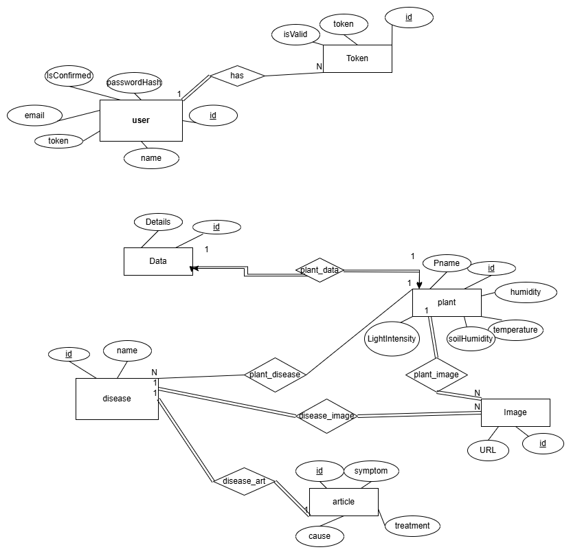

# PlantCare Backend

ASP.NET Core backend from the PlantCare Computer Science graduation project. This repository contains the C# backend; the React interface and Python image-classification service are separate projects.

This is a sanitized academic source snapshot, not a production-ready release. The import preserves the original project names, target framework and business logic. Configuration cleanup is described in [Import notes](docs/IMPORT_NOTES.md); deployment limitations are in [Security and validation](docs/VALIDATION.md).

## Implemented in the source

- Account registration, login, email confirmation, password recovery and reset using ASP.NET Core Identity and SMTP.
- JWT generation and token records stored with EF Core.
- SQL Server entities, relationships and migrations for users, tokens, plants, diseases, images, articles and environmental information.
- Plant library and disease-detail queries using LINQ and EF Core.
- Image upload forwarding to a separate FastAPI classifier, followed by an AI-generated disease explanation.
- Gemini-backed plant-care chat and environmental advice endpoints.
- Swagger/OpenAPI documentation and custom exception/validation responses.

These describe code paths in the snapshot. They do not imply that the original external services are still available or that all flows have been tested end to end.

## Structure

| Project | Responsibility |
|---|---|
| `WebApplication1` | ASP.NET Core API, controllers, DTOs, middleware and application configuration |
| `WebApplication1.Core` | Domain entities and interfaces |
| `WebApplication1.Repositry` | EF Core context, SQL Server migrations and repository implementation |
| `WebApplication1.Service` | Authentication, JWT, email and provider services |

The original `Repositry` spelling is preserved to avoid breaking namespaces and references during import.



[Database schema diagram](docs/database-schema-diagram.png)

## Requirements

- .NET 8 SDK to reproduce the original target.
- A local SQL Server instance or SQL Server LocalDB for database-backed flows.
- Your own SMTP and provider credentials for the optional external integrations.

.NET 8 reached end of support in November 2026. Its use here records the historical implementation. Upgrade and review dependencies before any production use; see the [official support policy](https://dotnet.microsoft.com/en-us/platform/support/policy/dotnet-core).

## Local setup

From the repository root:

```powershell
dotnet restore WebApplication1.Solution.sln
dotnet build WebApplication1.Solution.sln --no-restore

# Use a LOCAL development database; never reuse the original hosted credentials.
$env:ConnectionStrings__DefaultConnection = "Server=(localdb)\mssqllocaldb;Database=PlantCarePortfolio;Trusted_Connection=True;TrustServerCertificate=True;"
$env:JWT__key = "<your-random-development-signing-key-at-least-32-bytes>"
$env:ASPNETCORE_ENVIRONMENT = "Development"
dotnet run --project WebApplication1/WebApplication1.Api.csproj --no-launch-profile --urls http://localhost:5080
```

Open `http://localhost:5080/swagger`. The application attempts EF Core migrations at startup. If SQL Server is missing or inaccessible, migration errors are logged; starting the process alone does not prove database-backed endpoints work. The database backup and its original rows are intentionally not distributed; the library will need your own non-sensitive seed data.

### Environment configuration

ASP.NET Core maps double underscores to configuration sections. Set these variables in your local environment as needed; do not commit values:

| Variable | Purpose |
|---|---|
| `ConnectionStrings__DefaultConnection` | Local SQL Server connection string |
| `JWT__key`, `JWT__issuer`, `JWT__audience` | JWT settings |
| `EmailSetting__SmtpServer`, `EmailSetting__port` | SMTP host and port |
| `EmailSetting__Username`, `EmailSetting__Password`, `EmailSetting__From` | Your SMTP identity and sender |
| `Gemini__ApiKey` | Gemini key for the three AI controllers |
| `Cloudinary__CloudName`, `Cloudinary__ApiKey`, `Cloudinary__ApiSecret` | Cloudinary integration settings |
| `OpenAi__Key` | Legacy optional ChatGPT service setting |

No provider keys are included. Provider calls have not been exercised during publication. The source contains historical model identifiers, frontend origins and classifier URLs; review them before enabling integrations. An `.env` file is not loaded automatically by this project.

## Main routes

Use Swagger for the request schemas and exact HTTP contracts.

| Area | Examples |
|---|---|
| Accounts | `POST /User/register`, `POST /User/login`, `GET /User/emailConfirmation` |
| Recovery | `POST /User/forget-password`, `POST /User/reset-password` |
| Session records | `POST /User/logout` |
| Library | `GET /library/getall`, `GET /library/{id}` |
| Classification | `POST /FloraCheck/predict` with a multipart `file` |
| Chat | `POST /Chatbot/chat` |
| Environmental advice | `POST /analysisBot` |

## Related projects

- [React interface](https://github.com/paula-girgis/PlantCareHub)
- [FastAPI classifier](https://github.com/paula-girgis/fastFloroCheck)

The original project was developed in a team. Publication under this account does not imply sole authorship of every component. No new license has been assigned during import.
